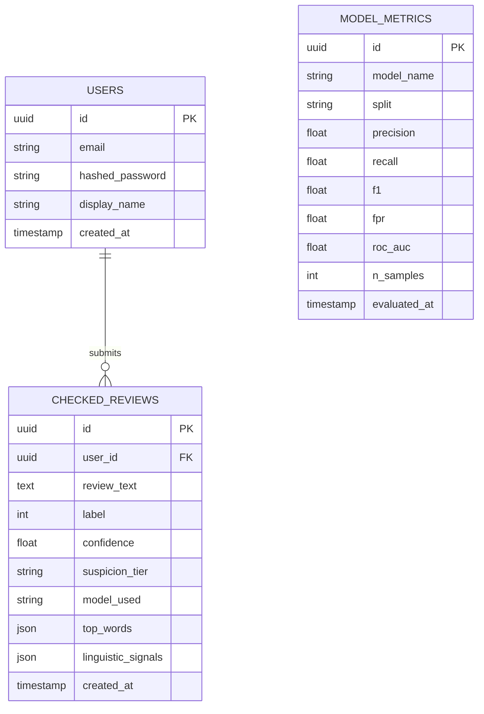

# Database Architecture – Fake Review Detection System

## Entity-Relationship Overview



## Table Definitions (PostgreSQL DDL)

```sql
CREATE EXTENSION IF NOT EXISTS "pgcrypto";

CREATE TABLE users (
    id              UUID PRIMARY KEY DEFAULT gen_random_uuid(),
    email           VARCHAR(255) UNIQUE NOT NULL,
    hashed_password VARCHAR(255) NOT NULL,
    display_name    VARCHAR(100),
    created_at      TIMESTAMPTZ DEFAULT NOW()
);

CREATE TABLE checked_reviews (
    id                 UUID PRIMARY KEY DEFAULT gen_random_uuid(),
    user_id            UUID REFERENCES users(id) ON DELETE SET NULL,
    review_text        TEXT NOT NULL,
    label              SMALLINT NOT NULL,         -- 1=deceptive, 0=genuine
    confidence         NUMERIC(6,4) NOT NULL,
    suspicion_tier     VARCHAR(10) NOT NULL,       -- Low / Medium / High
    model_used         VARCHAR(50) DEFAULT 'lr',
    top_words          JSONB,
    linguistic_signals JSONB,
    created_at         TIMESTAMPTZ DEFAULT NOW()
);

CREATE TABLE model_metrics (
    id           UUID PRIMARY KEY DEFAULT gen_random_uuid(),
    model_name   VARCHAR(50) NOT NULL,
    split        VARCHAR(30) NOT NULL,            -- test_indomain / test_cross
    precision    NUMERIC(6,4),
    recall       NUMERIC(6,4),
    f1           NUMERIC(6,4),
    fpr          NUMERIC(6,4),
    roc_auc      NUMERIC(6,4),
    n_samples    INTEGER,
    evaluated_at TIMESTAMPTZ DEFAULT NOW()
);

-- Indexes
CREATE INDEX idx_checked_reviews_user ON checked_reviews(user_id);
CREATE INDEX idx_checked_reviews_created ON checked_reviews(created_at DESC);
CREATE INDEX idx_model_metrics_name ON model_metrics(model_name, split);
```

## Notes

- `checked_reviews.top_words` stores `[{"word": "...", "weight": 0.42}, …]`
- `checked_reviews.linguistic_signals` stores the dict from `explainability.py`
- Soft-delete pattern: `user_id` is set to NULL if a user is deleted (preserves history)
- For the MVP, authentication uses JWT (python-jose) served through FastAPI's OAuth2 scheme
